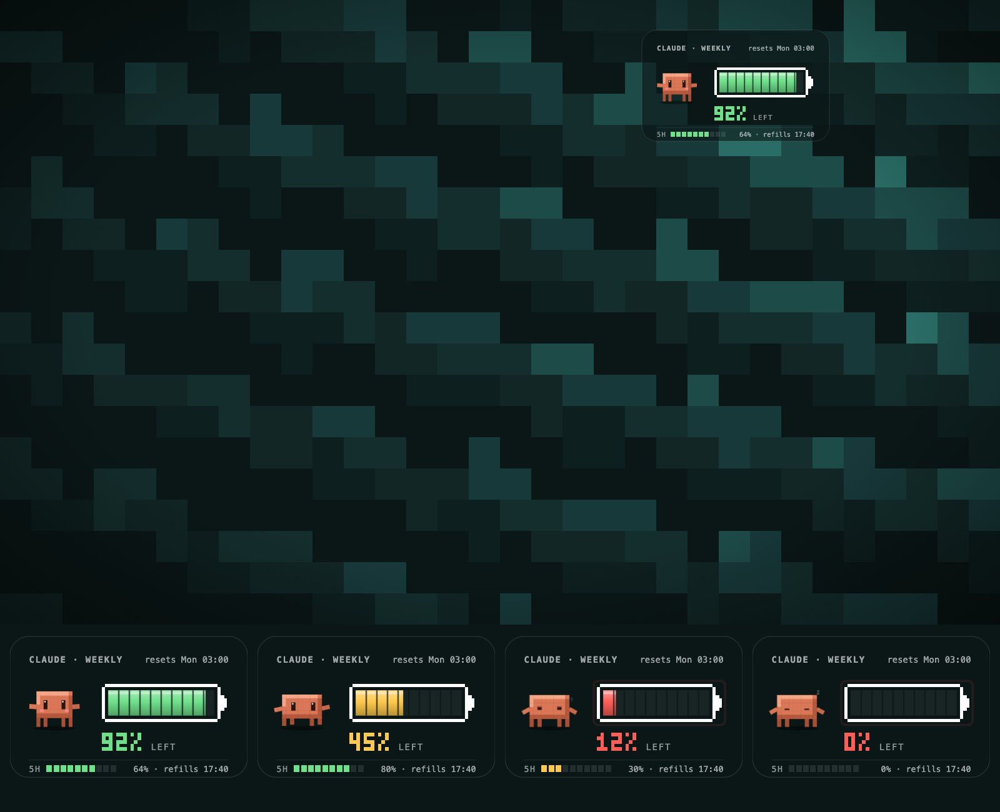

# Claude battery 🔋

Clawd stands beside a pixel battery that shows how much of your **weekly** Claude usage is left. It sits on the Claude Desktop background and moves on its own.



- **Above 60% left:** Clawd hops and waves, with sparkles around.
- **21–60% left:** it walks back and forth.
- **20% or less:** it gets tired, the battery turns red and a warning frame pulses.
- **0% left:** it falls asleep and z's float up.
- **Header:** shows when the weekly limit resets.
- **Bottom row:** shows the 5-hour window and when it refills.

The figures refresh after each answer, and the reset clock every minute. Every motion is CSS, so it stays smooth, and it switches off when your system asks for reduced motion.

## Install

At the prompt of a Claude Code terminal session:

```
/plugin install usage-battery --marketplace Handsher/usage-battery
```

Follow the prompts to add the marketplace and choose where the battery sits.

From a shell:

```
claude plugin install usage-battery --marketplace Handsher/usage-battery
```

In the desktop app, where `/plugin` does not run: click **+** next to the prompt box, then **Plugins**, then **Add marketplace** with `Handsher/usage-battery`, then **Add plugin**.

## Settings

| Option | Values | Default |
| --- | --- | --- |
| Position | `top-right`, `right`, `bottom-right`, `top-left`, `bottom-left` | `top-right` |
| Size | `small`, `medium`, `large` | `medium` |

To change a setting later, open the plugin's config menu.

## Good to know

- **Desktop app only.** The battery is drawn on the Claude Desktop (and mobile) background. A terminal draws no background.
- **It is a theme.** A session has one theme, so the battery, with its own dark pixel backdrop, takes the place of another theme mod's look (its background and colors). Turn the plugin off and start a new session to get your theme back.
- **Which number it shows.** On a Pro or Max plan the battery shows the weekly limit. With no plan limits, such as when you use an API key, it shows the context window instead.
- **What it reads.** The mod uses Claude Code's own usage figures. It sends nothing anywhere.

This mod is made by fans and is not affiliated with Anthropic.
